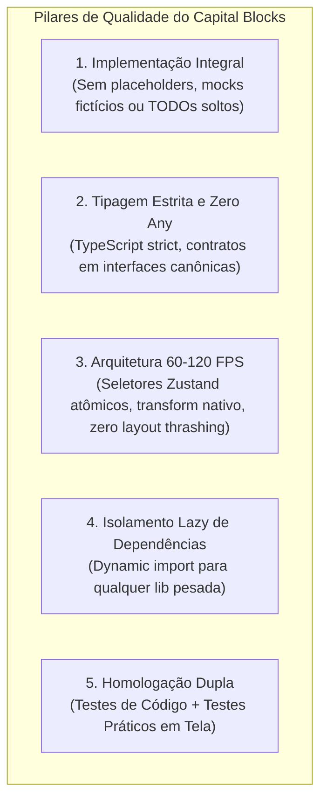
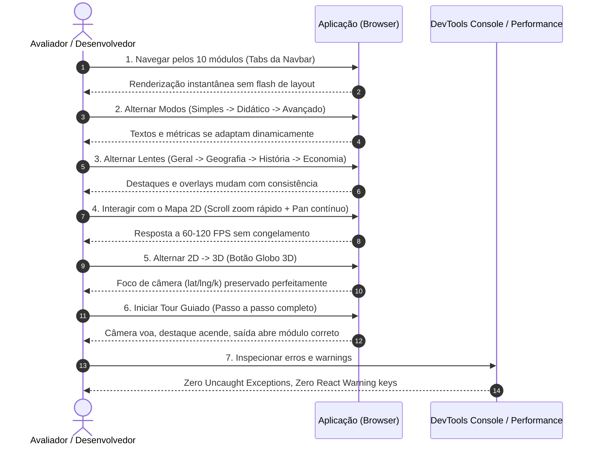
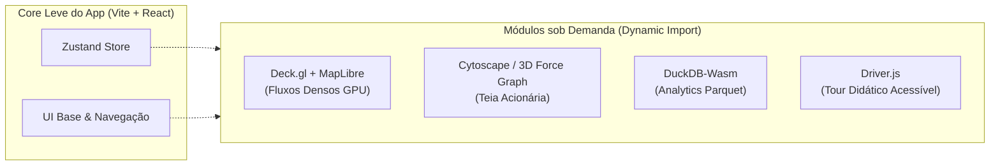

# Roadmap Master de Engenharia e Conclusão: Capital Blocks

Este documento estabelece o diagnóstico integral, as práticas de engenharia de software de nível de produção, a avaliação de novas tecnologias (Deck.gl, Cytoscape/3D Force Graph, DuckDB-Wasm, Driver.js) e o plano de evolução arquitetural em 6 etapas sequenciais.

> [!IMPORTANT]
> **Protocolo Obrigatório de Fechamento de Etapa:** Nenhuma etapa pode ser dada por encerrada sem cumprir o **Protocolo de Homologação Contínua**:
> 1. Execução de 100% dos testes automatizados de código.
> 2. Roteiro de testes práticos de navegação (entrando nas páginas e interagindo com os componentes).
> 3. Resolução imediata de qualquer bug, erro de console ou jank identificado.
> 4. Auditoria de build de produção (`npm run build`).
> 5. Commit semântico e envio para o repositório remoto (`git push`).

---

## 1. Princípios de Engenharia e Boas Práticas

Para blindar o aplicativo contra dívida técnica, regressões e código mal-acabado, toda implementação deve aderir aos seguintes pilares:

1. **Implementação Integral (Zero Placeholders/Mocks Fictícios):**
   - Nenhuma funcionalidade deve ser entregue pela metade ou com estruturas falsas que quebrem em produção. Todos os dados, cálculos, rotas e componentes devem ser plenamente funcionais desde a primeira inserção.
2. **Tipagem Estrita e Integridade Estrutural:**
   - Todo dado e estado deve ter interfaces estritas em TypeScript (`tsc -b`). O uso de `any` ou type-casts cegos é estritamente proibido.
3. **Desempenho Sem Concessões (60–120 FPS):**
   - Nunca subscrever um componente à store inteira do Zustand: use sempre seletores atômicos (`useApp(s => s.meuDado)`).
   - O mapa 2D deve preservar a **Arquitetura Dourada**: `viewportRef` com aplicação direta do `transform` via `requestAnimationFrame`, `zoomTier` estável (sem re-criar elementos SVG e SMIL no zoom contínuo) e cache de dimensões para eliminar *layout thrashing*.
   - Supressão de filtros caros (`drop-shadow`) e keyframes pesados durante gestos ativos (`isInteracting`).
4. **Isolamento de Chunks e Carga Dinâmica:**
   - Todas as novas bibliotecas gráficas e de dados (Deck.gl, MapLibre, Cytoscape, 3D Force Graph, DuckDB-Wasm) devem ser carregadas via `React.lazy()` e dynamic import (`import()`), mantendo o bundle inicial leve (< 150 kB) e garantindo LCP < 1.5s.
5. **Preservação de Invariantes e Não-Regressão:**
   - Nenhuma mudança pode quebrar os 10 módulos existentes, seus contratos visuais ou os testes pré-existentes.

---

## 2. Protocolo de Homologação: O que testar no final de cada etapa

No encerramento de cada uma das 6 etapas, o desenvolvedor/agente deve executar a **Dupla Bateria de Homologação**:

### A. Bateria de Testes de Código (Automatizados)

| Teste | Comando | Objetivo e Invariantes |
| :--- | :--- | :--- |
| **Testes Unitários / Integração** | `npm test` | Executar todas as 9 suites do Vitest (107+ testes). Garantir 100% de aprovação em lógica de Marx, métricas financeiras, conversão BRAPI, dualmode e store Zustand. |
| **Voo e Câmera 3D do Globo** | `npm run test:globe` | Testar todos os 448 voos de câmera entre paradas. Garantir `destino exato + zero roll + nunca invertido`. |
| **Enquadramento de Fluxos** | `npm run test:framing` | Testar todas as 52 rotas de fluxo internacional. Garantir cálculo de ponto médio 3D e enquadramento dentro do frustum da câmera. |
| **Contratos Estruturais de Tours** | `npm run test:tours` | Validar todas as paradas dos tours: unicidade de IDs, cobertura de paradas, saídas de tour e consistência dos números. |
| **Auditoria Editorial e BNCC** | `npm run test:tours:editorial` | Validar se todas as paradas possuem textos nos 3 modos (`simples`, `did`, `adv`), verificar ausência de termos marxistas sem explicação no modo didático e checar dicas de ação. |
| **Compilação e Tipagem Estrita** | `npm run build` | `tsc -b && vite build`. Garantir zero erros de compilação TypeScript e validar que o tamanho dos chunks gerados está dentro dos limites. |

### B. Bateria de Testes Práticos (Manual / Navegação em Tela)

O executor deve rodar `npm run dev` e acessar a aplicação no navegador (desktop e emulação mobile) para cumprir o seguinte roteiro prático:

#### Checklist de Verificação Prática:
1. **Navegação pelos 10 Módulos:**
   - Acessar sequencialmente: `home` $\rightarrow$ `companies` $\rightarrow$ `war` $\rightarrow$ `circuit` $\rightarrow$ `debt` $\rightarrow$ `wealth` $\rightarrow$ `consequences` $\rightarrow$ `alternatives` $\rightarrow$ `platform` $\rightarrow$ `sources`.
   - Verificar se cards, gráficos e tabelas carregam com dados consistentes.
2. **Teste dos 3 Níveis de Leitura e 4 Lentes:**
   - No seletor global do header, alternar entre `simples`, `didatico` e `avancado`.
   - Conferir se no **Modo Simples** o texto é direto e sem jargões indecifráveis; se no **Modo Didático** aparecem as conexões com a aula; e se no **Modo Avançado** surgem as identidades contábeis formais ($c, v, m$, notas metodológicas).
   - Alternar as lentes (`geral`, `geografia`, `historia`, `economia`) e verificar a reação temática dos módulos.
3. **Teste de Gestos do Mapa 2D e Globo 3D:**
   - Realizar zoom rápido (roda do mouse e pinch no touch) de 1x a 10x: garantir que a tela não engasga (zero jank).
   - Clicar em países (EUA, China, Brasil, Alemanha, etc.) e verificar abertura do Drawer lateral com as frações de capital.
   - Clicar em fluxos (linhas coloridas) e verificar abertura do `FlowCard`.
   - Clicar no botão **"🌐 3D"** e verificar se a câmera 3D pousa exatamente na mesma região geográfica analisada no 2D.
4. **Teste de Ponta a Ponta dos Tours:**
   - Iniciar o tour modificado na etapa.
   - Avançar passo a passo com cliques e com as setas do teclado ($\leftarrow$ / $\rightarrow$).
   - Verificar se as rotas e países destacados acendem na cor correta.
   - No passo final, clicar no botão de encerramento e certificar-se de que a aba de destino abre sem travamento.
5. **Teste Responsivo e Mobile:**
   - Abrir no modo responsivo (375x812 - iPhone/Android).
   - Testar a barra de ferramentas inferior, o bottom sheet de camadas e o drawer de países sem overflow horizontal de tela.
6. **Inspeção de Console e Performance:**
   - Abrir DevTools Console: **proibido qualquer erro vermelho (`Uncaught`, `TypeError`, `NaN`) ou warning de chaves React repetidas**.
   - Abrir DevTools Performance / FPS meter: taxa estável de 60 FPS durante o uso contínuo.

---

## 3. Avaliação e Arquitetura das Novas Tecnologias

A integração de novas bibliotecas deve obedecer à regra de **não inflar o bundle inicial** e carregar sob demanda via `dynamic import()` apenas quando o recurso for acionado.

### A. Deck.gl + MapLibre GL (Fluxos Globais a 60 FPS na GPU)
- **Função:** Renderização de grandes massas de fluxos bilaterais de comércio global em 60–120 FPS via shaders de vértices da GPU (`ArcLayer`).
- **Estratégia:** Mantém o mapa SVG nativo leve como padrão (ótimo para celulares simples e carga rápida) e adiciona o botão comutador **"Modo GPU (Alta Densidade)"**.
- **Licenças:** Deck.gl (MIT) e MapLibre GL (BSD 3-Clause) — permissivas e sem necessidade de tokens de terceiros.

### B. Cytoscape.js + 3D Force Graph (Teias de Controle Acionário)
- **Função:** Visualização interativa da rede de controle corporativo e participações cruzadas dos fundos transnacionais ("Big Three": BlackRock, Vanguard, State Street) nos conglomerados mundiais e na B3.
- **Implementação:**
  - *2D (Cytoscape.js):* Grafo concêntrico/hierárquico com clustering no Módulo 02 (`CompaniesModule.tsx`).
  - *3D (3D Force Graph):* Modo imersivo WebGL com gravidade nodal para explorar conglomerados por fração de capital.
- **Licenças:** Cytoscape.js (MIT) e 3D Force Graph (MIT).

### C. DuckDB-Wasm (Processamento Analítico no Browser via Parquet)
- **Função:** Executar consultas SQL analíticas em tempo real sobre arquivos `.parquet` estáticos (MDIC Comex Stat, Penn World Table 10.0, BEA) via requisições HTTP Range no cliente, sem necessidade de backend.
- **Implementação:** Web Worker isolado integrado ao Módulo 10 (`SourcesModule.tsx`), com consultas pré-programadas para sala de aula e terminal SQL aberto para pesquisadores universitários.
- **Licença:** DuckDB-Wasm (MIT).

### D. Driver.js (Tours Didáticos Acessíveis com Sincronia de Câmera)
- **Função:** Orquestração de passos guiados com máscara de spotlight escuro, popovers explicativos acessíveis e sincronização com o voo de câmera 2D e 3D.
- **Licença:** Driver.js (MIT) — ultraleve (~5 KB).

---

## 4. Cronograma Detalhado do Roadmap (6 Etapas Auditáveis)

---

### ETAPA 1: Blindagem Editorial, Lentes Disciplinares e BNCC

**Objetivo:** Concluir a camada de conteúdo dos 10 módulos nos 3 modos de leitura e integrar metadados educacionais formais.

- [x] **1.1. Refatoração Completa do Modo Simples (`src/lib/simples.ts`):**
  - Auditar e refinar substituições léxicas, garantindo frases curtas e vocabulário acessível ao Ensino Fundamental II sem perda de rigor conceitual.
- [x] **1.2. Implementação das Notas Metodológicas no Modo Avançado:**
  - Criar componente `<MethodologyNote />` para explicitar a identidade contábil e a conversão de balanços corporativos e Contas Nacionais em $c$, $v$, $m$ e fração fictícia (metodologia Shaikh & Tonak / PWT / SNA).
  - Inserir notas em: `src/data/marx.ts`, `src/data/companies.ts`, `src/data/debt.ts` e `src/data/theory.ts`.
- [x] **1.3. Matriz BNCC e Roteiro de Aula para Docentes:**
  - Mapear habilidades da BNCC (EF08GE, EF09GE, EF09HI, EM13CHS) e adicionar cabeçalho pedagógico colapsável em cada módulo com: Tempo sugerido, Pergunta disparadora e Link compartilhável.
- [x] **1.4. Ativação Global das Lentes Disciplinares (`lens`):**
  - Propagar a lente ativa (`geral`, `geografia`, `historia`, `economia`) para filtros e cards nos 10 módulos.

#### Checklist de Homologação da Etapa 1:
- [x] `npm test` aprovado (107+ testes).
- [x] `npm run test:tours:editorial` executado com 0 erros e 0 avisos.
- [x] Teste prático de navegação: alternar entre Simples, Didático e Avançado em todos os 10 módulos e verificar a mudança contextual sem erros de renderização.
- [x] `npm run build` executado com sucesso (zero erros de TypeScript).
- [x] Commit e push: `feat(editorial): maturidade dos modos simples/avancado, notas metodologicas e matriz BNCC`.

---

### ETAPA 2: Integração do Driver.js e Padronização dos Tours

**Objetivo:** Unificar a base de tours, sincronizar spotlight da interface com a câmera 2D/3D e garantir acessibilidade total.

- [x] **2.1. Unificação Arquitetural dos Tours:**
  - Consolidar a definição canônica de paradas em um único ponto da verdade (`src/data/tours.ts`).
- [x] **2.2. Integração do Driver.js com Sincronia de Câmera:**
  - Encapsular `driver.js` via hook `useTourDriver()`, disparando `flyToLL` e foco geográfico na ativação de cada passo.
  - Habilitar navegação acessível por teclado (setas e Escape).
- [x] **2.3. Paradas com Perguntas Disparadoras e Quizzes:**
  - Integrar desafios conceituais com feedback didático imediato em paradas estratégicas.
- [x] **2.4. Auditoria de Contratos e Enquadramentos de Todos os Tours:**
  - Garantir que as 56 paradas dos 9 tours possuam saídas limpas e enquadramentos sem trepidação.

#### Checklist de Homologação da Etapa 2:
- [x] `npm run test:tours` e `npm run test:globe` passando com 100% de sucesso.
- [x] Teste prático de navegação: iniciar e concluir os tours `principal`, `aula-geografia`, `aula-historia` e `aula-economia`, testando avanço por teclado, popover spotlight e saída para o módulo de destino.
- [x] `npm run build` executado com sucesso.
- [x] Commit e push: `feat(tours): integracao driver.js, unificacao de dados e quizzes disparadores`.

---

### ETAPA 3: Teias de Controle Acionário (Cytoscape.js & 3D Force Graph)

**Objetivo:** Revelar a concentração do capital financeiro através de redes interativas de participações acionárias cruzadas.

- [x] **3.1. Estruturação do Dataset de Participações Cruzadas (`src/data/ownership.ts`):**
  - Mapear nós de custodiantes globais (BlackRock, Vanguard, State Street) e as arestas societárias (%) nas corporações globais e da B3.
- [x] **3.2. Implementação do Grafo 2D com Cytoscape.js:**
  - Componente `<CorporateNetworkGraph />` em `CompaniesModule.tsx` com carregamento lazy e layout concêntrico interativo.
- [x] **3.3. Modo 3D Force Graph (Imersivo):**
  - Visualizador WebGL de clusters de poder econômico, agrupando conglomerados por fração de capital.
- [x] **3.4. Filtros por Fração de Capital:**
  - Comutadores para isolar capital produtivo, bancos ou fundos institucionais.

#### Checklist de Homologação da Etapa 3:
- [x] Testes unitários para validar a integridade dos nós e arestas de acionistas.
- [x] Teste prático de navegação: abrir o Módulo 02 (`companies`), abrir o painel da Teia Acionária, clicar em um fundo (ex.: Vanguard), verificar o destaque de todas as empresas investidas e alternar entre visualização 2D e 3D.
- [x] Verificação de bundle: confirmar que Cytoscape e 3D Force Graph foram empacotados em chunks lazy separados.
- [x] `npm run build` executado com sucesso.
- [x] Commit e push: `feat(network): teia interativa de controle acionario com cytoscape e force-graph`.

---

### ETAPA 4: Renderização de Fluxos Globais a 60 FPS na GPU (Deck.gl + MapLibre GL)

**Objetivo:** Disponibilizar visualização de altíssima densidade para centenas de fluxos de comércio e cabos submarinos sem degradação de FPS.

- [x] **4.1. Configuração do Deck.gl com ArcLayer:**
  - Criar componente `<GpuFlowMap />` com renderização WebGL2/WebGPU via `DeckGL` e basemap vetorial MapLibre GL.
- [x] **4.2. Shaders e Animação de Fluxo na GPU:**
  - Animação de partículas e arcos calculada diretamente nos shaders, mantendo 60–120 FPS mesmo com alta densidade de rotas.
- [x] **4.3. Chave de Comutação Transparente:**
  - Seletor simples: "Mapa Leve (SVG)" $\leftrightarrow$ "Mapa GPU (Deck.gl)", garantindo fallback gracioso para dispositivos simples.
- [x] **4.4. Sincronia de Câmera 2D/3D mantida:**
  - Integração contínua com `sharedMap` do Zustand.

#### Checklist de Homologação da Etapa 4:
- [x] Teste de stress de FPS: monitorar taxa de quadros (60+ FPS constante durante rotação e zoom).
- [x] `npm run test:framing` aprovado para todas as 52 rotas.
- [x] Teste prático de navegação: alternar entre o mapa SVG e o mapa GPU, navegar pelas rotas, inspecionar tooltips e alternar para o Globo 3D mantendo as coordenadas.
- [x] `npm run build` executado com sucesso.
- [x] Commit e push: `feat(gpu-map): renderizacao de fluxos massivos via deck.gl e maplibre`.

---

### ETAPA 5: Processamento Analítico no Browser (DuckDB-Wasm)

**Objetivo:** Capacitar estudantes e pesquisadores a analisar datasets reais (comércio exterior Comex Stat, Penn World Table) via SQL no client.

- [x] **5.1. Setup do DuckDB-Wasm e Web Worker:**
  - Inicialização sob demanda com isolamento em Web Worker dedicado (`src/lib/duckdb/`).
- [x] **5.2. Geração e Hospedagem de Arquivos Parquet Otimizados:**
  - Converter bases históricas de comércio bilateral e indicadores macroeconômicos em arquivos `.parquet` particionados em `public/data/`.
- [x] **5.3. Interface do Laboratório de Dados em SourcesModule:**
  - Adicionar aba com queries didáticas pré-programadas e console SQL interativo com exportação CSV.

#### Checklist de Homologação da Etapa 5:
- [x] Testes automatizados executando queries SQL básicas sobre arquivos Parquet.
- [x] Teste prático de navegação: abrir o Módulo 10 (`sources`), selecionar o Laboratório de Dados, executar uma consulta SQL pronta, verificar a montagem da tabela em menos de 100ms e testar exportação.
- [x] Monitoramento de memória: verificar no DevTools Memory que a instância WASM não causa vazamentos após execução de múltiplas queries.
- [x] `npm run build` executado com sucesso.
- [x] Commit e push: `feat(analytics): motor duckdb-wasm e laboratorio sql sobre dados parquet`.

---

### ETAPA 6: Auditoria Final, Otimização Extrema, Acessibilidade e Lançamento

**Objetivo:** Refino final, polimento visual, acessibilidade WCAG 2.1 AA, documentação e entrega da versão definitiva.

- [x] **6.1. Otimização Final de Bundles (Vite Rollup Chunking):**
  - Configurar `manualChunks` estritos para garantir que nenhum chunk individual exceda os limites recomendados de performance web.
- [x] **6.2. Auditoria Completa de Acessibilidade (a11y):**
  - Contraste de cores conforme WCAG AA e anúncios para leitores de tela em seleções de mapa e tours.
- [x] **6.3. Bateria Completa de Testes de Regressão:**
  - Execução sequencial de todos os scripts de auditoria (`test`, `test:globe`, `test:framing`, `test:tours`, `test:tours:editorial`).
  - Varredura prática completa em desktop e mobile.
- [x] **6.4. Documentação de Uso e Guia do Professor:**
  - Criação do Guia Didático do Professor e Nota Metodológica Consolidada em Markdown.
  - Tag de lançamento final `v1.1.0-release`.

#### Checklist de Homologação da Etapa 6:
- [x] 0 erros e 0 warnings em todos os testes e builds.
- [x] Console do navegador 100% limpo em todos os 10 módulos.
- [x] Build verde em produção (`npm run build`).
- [x] Commit e push: `release: conclusao definitiva do capital-blocks v1.1.0`.

---

## 5. Matriz de Riscos e Estratégias de Mitigação

| Risco | Probabilidade | Impacto | Estratégia de Mitigação |
| :--- | :---: | :---: | :--- |
| **Inchaço do Bundle por bibliotecas pesadas (Three, Deck.gl, DuckDB)** | Alta | Alto | Dynamic imports (`import()`) obrigatórios para todas as bibliotecas novas; isolamento em chunks lazy que só baixam se o usuário abrir o módulo. |
| **Regressão de Performance no Mapa 2D SVG** | Média | Alto | Manter as diretrizes da Arquitetura Dourada: `viewportRef` com transform nativo, `zoomTier` estrito (sem re-criar SMILs) e throttling de layouts. |
| **Incompatibilidade de WebAssembly / WebGL em aparelhos antigos** | Média | Médio | Fallback gracioso automático: se WebGL2 ou WASM falharem, o app mantém os mapas SVG e os cálculos locais em memória JS pura. |
| **Quebra de Testes Legados de Tours** | Alta | Médio | Manter a API pública de `TOURES` e `TOUR_STOPS` inalterada; novos metadados devem ser estritamente aditivos (propriedades opcionais). |
